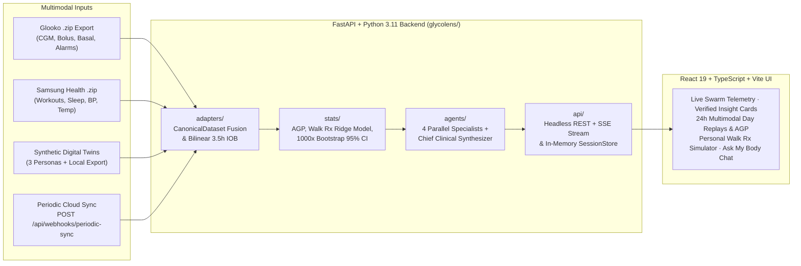

# GlycoLens

**Autonomous Multimodal Metabolic Pattern Discovery — Fusing CGM, Insulin Delivery, Smartwatch Workouts, Sleep Architecture & Blood Pressure**

GlycoLens aligns 5-minute continuous glucose monitor (CGM) traces and insulin pump/basal logs with smartwatch exercise sessions, sleep stages, skin temperature, respiratory rate, and blood pressure into a unified wall-clock timeline. Four parallel domain specialist agents propose personalized physiological hypotheses, verify every candidate against a deterministic **1,000-iteration nonparametric bootstrap (95% CI)** engine, and synthesize ranked, safety-gated insights in real time over Server-Sent Events (SSE).

---

## Architecture



### Module Breakdown

| Module | Path | Responsibility |
| :--- | :--- | :--- |
| **Schemas** | `backend/glycolens/schemas.py` | Strict Pydantic v2 contracts (`CanonicalDataset`, `DataProfile`, `StatisticalEvidence`, `InsightCard`, `SwarmStreamEvent`, `DiscoveryReport`) mirrored 1-to-1 in `frontend/src/types.ts`. |
| **Adapters** | `backend/glycolens/adapters/` | Parses Glooko CSV/ZIP exports (`glooko_adapter.py`) and Samsung Galaxy Watch exports (`samsung_watch_adapter.py`), computes 3.5h bilinear active insulin-on-board (`iob_units`), aligns UTC+offset smartwatch timestamps to local wall-clock time, and serves 3 synthetic personas (`personas.py`). |
| **Stats Engine** | `backend/glycolens/stats/` | Deterministic 24h Ambulatory Glucose Profile (AGP), 24h multimodal day replay selector, chronological 75/25 holdout 4-feature standardized Ridge regression (`fit_walk_model`, `simulate_walk`), 17 domain hypothesis probes across 4 physiological domains, and ad-hoc daily cohort split tool (`query_custom_cohort_split`). |
| **Agent Swarm** | `backend/glycolens/agents/` | Runs 4 parallel `google-genai` specialists (`Activity`, `Sleep`, `Dosing`, `Vitals`) with automatic function calling for confounder checks, followed by a structured-JSON `Chief Clinical Synthesizer` and deterministic clinical safety guardrails. Automatically falls back to deterministic `statistical_fallback` mode if no API key is configured. |
| **FastAPI + SSE** | `backend/glycolens/api/` | Stateless REST + live `text/event-stream` SSE discovery endpoint (`/api/sessions/{id}/discover/stream`), multipart `.zip` upload ingestion, Walk Rx simulation, grounded chat, and periodic cloud sync webhook. |
| **Frontend Lab** | `frontend/src/` | React + Tailwind CSS v4 + Recharts single-page exploration lab with live SSE swarm progress, paired-bar confidence visualizations, 24h day replay switcher, interactive Walk Rx simulator, and *Ask My Body* chat. |

### Clinical Safety Guardrails

Every insight card and chat response passes through deterministic post-generation guardrails (`enforce_medical_safety`):
- **Zero Dosing Prescriptions:** GlycoLens never prescribes or calculates insulin doses, unit adjustments, basal rates, or insulin-to-carb ratios.
- **3-Tier Action Classification:**
  - `habit_experiment` — Meal-timing rituals, post-meal movement, sleep consistency, and infusion site rotation.
  - `pre_activity_shield` — Pre-exercise active IOB + starting CGM checks, fueling buffers, and heart-rate zone pacing.
  - `doctor_discussion` — Any observation touching programmed pump ratios, basal schedules, target glucose, or cardiometabolic vitals is framed strictly as a question for the user's endocrinologist.

---

## Quickstart

### Prerequisites
- **Python 3.11+** with [`uv`](https://docs.astral.sh/uv/)
- **Node.js 20+** with `npm`

### 1. Start the Backend API (`http://localhost:8000`)

```bash
cd backend
uv sync
uv run python run_server.py
```

### 2. Start the Frontend Dev Server (`http://localhost:5173`)

In a second terminal:

```bash
cd frontend
npm install
npm run dev
```

Vite proxies `/api/*` requests directly to `http://127.0.0.1:8000` with SSE streaming enabled. Open **`http://localhost:5173`** in your browser.

---

## `GEMINI_API_KEY` Setup

GlycoLens supports two seamless operating modes:
1. **Gemini Multi-Agent Swarm Mode (`gemini_swarm`):** Uses `google-genai` (`gemini-3.8-flash` for parallel domain specialists & *Ask My Body* chat with automatic confounder tool-calling, plus structured Pydantic JSON synthesis in the Chief Clinical Synthesizer).
2. **Deterministic Statistical Mode (`statistical_fallback`):** Works **100% offline with zero API key**, running all 17 bootstrap hypothesis tests, Walk Rx Ridge regression, day replays, and deterministic cohort Q&A.

You can configure your Google AI Studio key in any of three ways:

- **Option A — Environment file (`backend/.env`, gitignored):**
  ```bash
  echo "GEMINI_API_KEY=your_api_key_here" > backend/.env
  ```
- **Option B — Shell environment variable:**
  ```bash
  export GEMINI_API_KEY="your_api_key_here"
  ```
- **Option C — Live in the UI:**
  Click **`Statistical Mode · Add Gemini Key`** in the top-right header (calls `POST /api/config/apikey`), which activates the key in memory, persists it locally to `backend/.env`, and immediately re-runs the swarm.

Optional model overrides via environment variables:
- `GEMINI_FAST_MODEL` (default: `gemini-3.8-flash`)
- `GEMINI_PRO_MODEL` (default: `gemini-3.8-flash`)

---

## Pluggable Adapter Design

All downstream statistical profiling, bootstrap hypothesis verification, Walk Rx modeling, and LLM synthesis operate exclusively on `CanonicalDataset` (`backend/glycolens/schemas.py`)—never on vendor-specific CSV schemas.

### Built-in Data Sources & Personas
- **Synthetic Digital Twins (`sample_data/synthetic/*.json`):**
  - `active_walker` — *Active Walker (AID Pump + Smartwatch)*: 98% manual zero-carb boluses, steep brisk-walk × active-IOB drops, +90 mg/dL wake surges, and late-night bolus rebounds.
  - `hiit_lifter` — *HIIT & Strength Athlete (Zone-5 vs Zone-2)*: Evening high-HR anaerobic catecholamine spikes (+65 mg/dL) vs morning Zone-2 aerobic runs (-35 mg/dL).
  - `bp_shiftworker` — *Shift Worker (T2D Basal + Daily BP & Watch)*: Short shift-sleep (<5.5h) systolic BP (+14 mmHg) & fasting glucose spikes vs 20-minute post-dinner walk rescues.
- **Direct `.zip` Export Upload (`POST /api/sessions/upload`):** Upload a Glooko export `.zip` alongside an optional Samsung Health `.zip` directly in memory—header banners containing patient names are stripped automatically.
- **Local Real Export Auto-Discovery (`local_real_export`):** If a local Glooko/Watch export directory is present on disk (or configured via `GLYCOLENS_LOCAL_GLOOKO_DIR` / `GLYCOLENS_LOCAL_WATCH_DIR`), GlycoLens surfaces it locally while `.gitignore` guarantees raw `.zip`/`.csv` files never enter version control.
- **Periodic Cloud Wearable/CGM Sync (`POST /api/webhooks/periodic-sync`):** Incremental JSON webhook that merges live CGM points, boluses, workouts, sleep summaries, and daily vitals into an active session and recomputes its profile on the fly.

### Adding a New Wearable or CGM Adapter
To add support for Dexcom Clarity, LibreView, Apple HealthKit, Oura, or Garmin:
1. Create `backend/glycolens/adapters/<vendor>_adapter.py` that maps raw records into `GlucosePoint`, `BolusEvent`, `WorkoutSession`, `SleepStageInterval`, `SleepSessionSummary`, and `DailyVitalsSummary`.
2. Reuse `enrich_glucose_and_boluses()`, `enrich_workouts_with_cgm()`, and `aggregate_and_enrich_sleep()` to attach 3.5h bilinear IOB, 15-minute CGM slopes, 90-minute workout nadirs, and 3-hour post-wake surges.
3. Return a `CanonicalDataset`—all 17 statistical probes, the Walk Rx simulator, the 5-agent Gemini swarm, and the React UI will work automatically with zero changes.

---

## Verification & Testing

```bash
# Run the full backend integration & end-to-end test suite
cd backend
uv run pytest -v

# Verify TypeScript compilation & production Vite bundle
cd ../frontend
npm run build
```

---

## Privacy & Clinical Disclaimer

- **Local-First Privacy:** Uploaded `.zip` archives are parsed in ephemeral memory, personal header rows are ignored, and `.gitignore` blocks `data/`, `uploads/`, `*.zip`, `*.csv` (except synthetic fixtures), and `.env*` files.
- **Educational Use Only:** GlycoLens is an exploratory personal data science application and is **not** a medical device. Always consult a qualified physician or diabetes care team before making any changes to insulin therapy or medical treatment.
