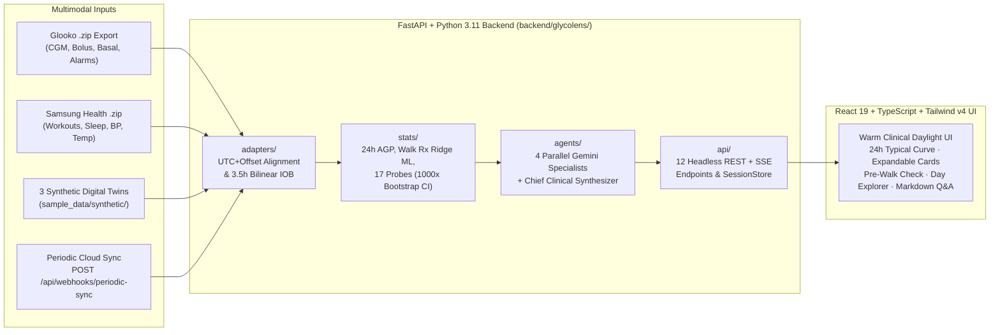

# GlycoLens

[](./LICENSE)
[](./backend/pyproject.toml)
[](./docs/API_REFERENCE.md)
[](./frontend/package.json)
[](https://youtu.be/JS5oRk-guWk)

**Autonomous Multimodal Metabolic Pattern Discovery — Fusing CGM, Insulin Delivery, Smartwatch Workouts, Sleep Architecture & Blood Pressure**

GlycoLens aligns 5-minute continuous glucose monitor (CGM) traces and insulin logs with smartwatch workouts, sleep stages, skin temperature, respiratory rate, and blood pressure on a unified local wall-clock timeline. Four **parallel Gemini specialist agents** audit domain hypotheses, verify every candidate against a deterministic **1,000-iteration nonparametric bootstrap (95% CI)** statistical engine, and present calm, progressive-disclosure insights for everyday users—backed by expandable clinical evidence.

> **Pitch Video & Deep-Dive Documentation for Jury Evaluation:**
> - **[Watch the GlycoLens Pitch Video on YouTube (`https://youtu.be/JS5oRk-guWk`)](https://youtu.be/JS5oRk-guWk)** — Project pitch and live product walkthrough.
> - **[Technical Architecture & Mathematical Specification (`docs/TECHNICAL_ARCHITECTURE.md`)](./docs/TECHNICAL_ARCHITECTURE.md)** — Neuro-symbolic multi-agent sequence diagram, zero-hallucination statistical guarantee, 3.5h bilinear IOB equations, all 17 hypothesis probes, chronological-holdout Walk Rx Ridge regression, and 3-tier clinical safety guardrails.
> - **[Complete REST, SSE & Webhook API Reference (`docs/API_REFERENCE.md`)](./docs/API_REFERENCE.md)** — All 12 backend HTTP/SSE endpoints, request/response schemas, SSE event protocol, and Glooko / Samsung Health / Cloud Sync data contracts.

---

## Key Capabilities

1. **Calm, Progressive-Disclosure UX ("Understand in 5 Seconds, Click to Inspect Proof"):**
   - **Overview:** Plain-language Time-in-Range summary paired with a smooth 24-hour typical glucose curve highlighting your steadiest and peak hours.
   - **Actionable Findings:** Clean 2-bar *Before vs. After* cards that expand on click to reveal physiological explanations, sample counts, 95% confidence intervals, and clickable personal timestamps.
   - **Pre-Walk Blood Sugar Check:** Interactive simulator powered by a personalized 4-feature Ridge regression model (`StartCGM`, `Active IOB`, `Steps`, `Steps × IOB` synergy) trained on your own past walks.
   - **Day-by-Day Explorer & Grounded Q&A:** Inspect synchronized 24-hour replays (CGM + boluses + walks + sleep + BP) or ask natural-language questions in *Ask About Your Data* with live cohort-split tool calling.
2. **"LLM Audits, Code Proves, LLM Explains" Zero-Hallucination Design:**
   - LLM prose can **never** invent or alter statistics: `StatisticalEvidence` objects (means, sample sizes, 95% CIs, and chart bars) are computed deterministically in Python and re-attached by immutable `hypothesis_id` after Gemini structured synthesis.
3. **Dual-Mode Execution (Live Gemini Swarm + 100% Offline Fallback):**
   - Runs live 4-agent parallel `google-genai` orchestration when `GEMINI_API_KEY` is configured, and seamlessly falls back to deterministic `statistical_fallback` mode if run offline without a key.
4. **Strict 3-Tier Clinical Safety Guardrails:**
   - Never prescribes or calculates insulin doses. Automatically separates behavioral habits (`habit_experiment`) and pre-exercise checks (`pre_activity_shield`) from programmed pump/basal/carb-ratio observations, which are strictly gated as non-prescriptive questions for an endocrinologist (`doctor_discussion`).

---

## System Architecture



---

## APIs, Frameworks & Tools Used

| Layer | Technology / API | Version | Role in GlycoLens |
| :--- | :--- | :--- | :--- |
| **LLM & Agent SDK** | **Google Gemini API** (`google-genai`) | `>=3.3.0` | Parallel async specialist reasoning (`gemini-3.8-flash`), automatic Python tool calling (`query_custom_cohort_split`), structured Pydantic JSON synthesis (`response_schema`), and grounded Q&A. |
| **Backend Framework** | **FastAPI** + **Uvicorn** | `>=0.162` / `>=0.54` | Headless async REST API, `text/event-stream` Server-Sent Events (SSE) discovery streaming, multipart `.zip` upload handling, and auto-generated OpenAPI `/docs`. |
| **Data Contracts** | **Pydantic v2** | `>=2.14` | End-to-end typed contracts (`CanonicalDataset`, `DataProfile`, `StatisticalEvidence`, `InsightCard`, `SwarmStreamEvent`) shared 1-to-1 with TypeScript (`frontend/src/types.ts`). |
| **Stats & ML Engine** | **Pure Python Statistical & Ridge Engine** | Python `3.11+` | 1,000-iteration nonparametric bootstrap 95% CIs across 17 physiological probes, 24h Ambulatory Glucose Profile (AGP), and leak-free chronological-holdout 4-feature Ridge regression. |
| **Package & Env Mgmt** | **`uv`** + `python-dotenv` + `python-multipart` | Latest | Deterministic lockfile (`backend/uv.lock`), sub-second virtual environment creation, and isolated `.env` configuration. |
| **Frontend Framework** | **React 19** + **TypeScript** + **Vite 6** | `19.0` / `5.7` / `6.2` | Reactive SSE state streaming, custom zero-dependency interactive SVG charts (Catmull-Rom 24h AGP, 24h multimodal day replays), and `/api` dev proxy. |
| **Styling & UI** | **Tailwind CSS v4** + **Lucide React** + **Plus Jakarta Sans** | `4.0.9` | Warm Clinical Daylight design system with `tabular-nums` typography and progressive disclosure. |
| **Markdown Rendering** | **`react-markdown`** + **`remark-gfm`** | Latest | Renders GitHub-Flavored Markdown (bold stats, lists, tables, callouts) inside the *Ask About Your Data* slide-over drawer. |
| **Wearable & CGM Formats** | **Glooko CSV/ZIP** + **Samsung Health CSV/ZIP** + **Cloud Sync Webhook** | Vendor Exports | In-memory ingestion stripping patient name headers, filtering sensor error codes (`2001.0`), aligning UTC+offset DST timestamps, and supporting future Health Connect / Dexcom API sync. |
| **Testing & QA** | **Pytest** + **HTTPX** (`TestClient`) | `>=9.2` / `>=0.28` | End-to-end test suite (`backend/tests/test_e2e.py`) validating all 12 endpoints, synthetic persona specificity, in-memory ZIP ingestion, and medical safety guardrails. |

---

## Setup & Installation Steps

### Prerequisites
- **Python 3.11+** and **[`uv`](https://docs.astral.sh/uv/)** *(install `uv` in one command if needed: `curl -LsSf https://astral.sh/uv/install.sh | sh`)*
- **Node.js 20+** and **`npm`**
- *(Optional)* A **Google AI Studio `GEMINI_API_KEY`** — GlycoLens runs **immediately out of the box with zero API key** in deterministic Statistical Mode and automatically upgrades to the live 4-agent Gemini Swarm when a key is provided.

### 1. Clone the Repository
```bash
git clone https://github.com/DavidGinfo/glycolens.git
cd glycolens
```

### 2. Configure `GEMINI_API_KEY` *(Optional — Can Also Be Entered in the Web UI)*
```bash
cp backend/.env.example backend/.env
# Edit backend/.env and paste: GEMINI_API_KEY=your_key_here
```
*(Alternatively, start the app without `.env` and click **How this was verified → Set API Key** in the top bar at runtime.)*

### 3. Install & Start the Backend Server (`http://localhost:8000`)
```bash
cd backend
uv sync
uv run python run_server.py
```
- Backend API runs at **`http://localhost:8000`**
- Interactive OpenAPI / Swagger UI runs at **`http://localhost:8000/docs`**

### 4. Install & Start the Frontend Web App (`http://localhost:5173`)
Open a second terminal:
```bash
cd frontend
npm install
npm run dev
```
Open **`http://localhost:5173`** in your browser. Vite automatically proxies `/api/*` requests and SSE streams to `http://127.0.0.1:8000`.

---

## Trying GlycoLens (Built-in Synthetic Personas & Custom Uploads)

Out of the box, use the profile selector in the top bar to switch between three anonymized synthetic digital twins (`sample_data/synthetic/*.json`):
- **`Active Walker (AID Pump + Smartwatch)`** — Demonstrates active bolus insulin $\times$ brisk walk glucose drops, unprotected walk hypoglycemia risk, $+90\text{ mg/dL}$ wake-up surges, and late meal bolusing.
- **`HIIT & Strength Athlete (Zone-5 vs Zone-2)`** — Demonstrates evening high-heart-rate anaerobic adrenaline spikes ($+65\text{ mg/dL}$) vs. morning Zone-2 aerobic drops ($-35\text{ mg/dL}$).
- **`Shift Worker (T2D Basal + Daily BP & Watch)`** — Demonstrates short shift-sleep ($<5.5\text{h}$) driving next-day hyperglycemia & systolic blood pressure surges ($+14\text{ mmHg}$), plus post-dinner walk rescues.
- **Custom `.zip` Import:** Click **`Import`** in the top bar to evaluate any Glooko `.zip` export paired with an optional Samsung Health smartwatch `.zip` export directly in memory.

---

## API Quick Summary

Full payload examples and SSE schemas are documented in **[`docs/API_REFERENCE.md`](./docs/API_REFERENCE.md)**:

- `GET /api/health` · `POST /api/config/apikey` — Engine health & runtime Gemini key setup
- `GET /api/personas` · `POST /api/sessions/persona/{id}` · `POST /api/sessions/upload` — Dataset session creation
- `GET /api/sessions/{id}/profile` · `GET /api/sessions/{id}/replays` · `GET /api/sessions/{id}/report` — Profile, 24h replays & cached report
- `GET /api/sessions/{id}/discover/stream` — Live SSE stream from the 4 parallel specialists + Chief Synthesizer
- `POST /api/sessions/{id}/simulate/walk` — Personalized Walk Rx Ridge regression simulator
- `POST /api/sessions/{id}/chat` — Grounded *Ask About Your Data* Q&A with ad-hoc bootstrap split tool calling
- `POST /api/webhooks/periodic-sync` — Incremental cloud wearable / CGM sync webhook

---

## Automated Tests & Production Build Verification

```bash
# 1. Run end-to-end backend tests (all 12 routes, 3 personas, ZIP upload, webhook & safety guardrails)
cd backend
uv run pytest -v

# 2. Verify strict TypeScript compilation & production Vite bundle
cd ../frontend
npm run build
```

---

## Privacy, Security & License

- **Local-First Privacy:** Raw `.zip` exports are parsed in ephemeral memory, patient header lines are stripped on ingestion, and `.gitignore` strictly blocks `data/`, `uploads/`, `*.zip`, `*.csv` (except synthetic fixtures), and `.env*` secrets.
- **Clinical Disclaimer:** GlycoLens is an open-source educational pattern discovery project and is **not** a medical device. Never alter insulin doses, basal rates, or pump configurations without consulting a qualified healthcare professional.
- **License:** Released under the **[MIT License](./LICENSE)**.
