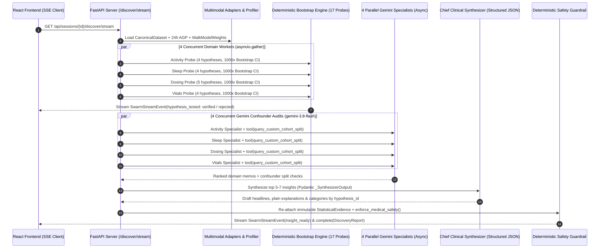

# GlycoLens Technical Architecture & Jury Evaluation Guide

GlycoLens solves a fundamental problem in personal diabetes & metabolic analytics:
- **Traditional diabetes dashboards** (Glooko, Clarity, LibreView) show static summary statistics or raw spaghetti plots without connecting *why* an excursion happened across external wearables (workouts, sleep stages, skin temperature, blood pressure).
- **Pure LLM wrappers** over CSVs hallucinate correlations, confuse random day-to-day noise for causal patterns, or risk giving unsafe dosing instructions.

GlycoLens implements a **Neuro-Symbolic Parallel Multi-Agent Architecture** (*"Specialists Audit → Deterministic Code Proves → Clinical Synthesizer Explains"*), combining deterministic nonparametric statistics and Ridge regression with parallel `google-genai` multi-agent reasoning.

---

## 1. End-to-End Multi-Agent Sequence & Zero-Hallucination Guarantee

### How Hallucinated Numbers Are Prevented by Design
1. **Immutable `StatisticalEvidence` Re-Attachment (`swarm.py:_assemble_gemini_insights`):**
   The Chief Synthesizer LLM outputs `_DraftInsightSpec` referencing an exact `hypothesis_id` from the verified pool—it **never** generates `StatisticalEvidence` chart bars, cohort sizes (`n_a`, `n_b`), means, or `95% CI` bounds. Python re-attaches the original deterministic `StatisticalEvidence` object directly by `hypothesis_id`. Any hallucinated or non-significant `hypothesis_id` is discarded automatically.
2. **Ad-Hoc Confounder Verification via Tool Calling (`query_custom_cohort_split`):**
   Both the 4 parallel specialists and *Ask About Your Data* chat receive a bound Python tool (`make_bound_cohort_tool`) that computes exact daily cohort splits (`steps`, `sleep_hours`, `bolus_units`, `systolic_bp`, `wrist_temp_c` vs. `tir_pct` or `mean_cgm`) using 1,000 bootstrap resamples rather than letting the LLM guess correlations.

---

## 2. Multimodal Signal Alignment & Physiological Feature Engineering

Implemented in `backend/glycolens/adapters/` and `backend/glycolens/stats/profiler.py`:

### A. Timezone & DST Wall-Clock Synchronization
- **Glooko CSVs** record events in local patient wall-clock time without explicit timezone offsets.
- **Samsung Galaxy Watch CSVs** record timestamps in `UTC` paired with a per-row `time_offset` column (e.g., `UTC+0200` in summer DST shifting to `UTC+0100` in autumn).
- `samsung_watch_adapter.py` parses each row's `time_offset` dynamically so overnight sleep wake-ups and afternoon walks align to the exact minute of local CGM readings—even across Daylight Saving Time transitions.

### B. 3.5-Hour Bilinear Active Insulin-on-Board (`IOB`) Model
Every 5-minute `GlucosePoint` and every `WorkoutSession` start timestamp is enriched with active bolus insulin-on-board (`iob_units`) summed over all prior boluses within `T = 210` minutes (`3.5` hours), modeling rapid-acting insulin peak action around 75 minutes:

$$
f(\Delta t) = \begin{cases}
1 - 0.25 \cdot \left(\frac{\Delta t}{75}\right) & \text{if } 0 \le \Delta t \le 75 \text{ min} \\
0.75 \cdot \left(1 - \frac{\Delta t - 75}{135}\right) & \text{if } 75 < \Delta t \le 210 \text{ min} \\
0 & \text{otherwise}
\end{cases}
$$

$$
\text{IOB}(t) = \sum_{b \in \text{Boluses}} u_b \cdot f(t - t_b)
$$

---

## 3. Deterministic Statistical Hypothesis Engine (17 Domain Probes)

Implemented in `backend/glycolens/stats/engine.py`. Every hypothesis compares two disjoint event or day cohorts $A$ ($n_A \ge 3$) and $B$ ($n_B \ge 3$) using a **seeded 1,000-iteration nonparametric bootstrap** (`seed = 42` for reproducibility):

1. Resample $A^* \sim \text{Uniform}(A, n_A)$ and $B^* \sim \text{Uniform}(B, n_B)$ with replacement $1,000$ times.
2. Compute $\Delta^{(k)} = \mu(A^{*(k)}) - \mu(B^{*(k)})$ for $k = 1 \dots 1000$.
3. Extract empirical percentile interval $[\text{CI}_{2.5\%}, \text{CI}_{97.5\%}]$.
4. Mark `statistically_significant = True` **if and only if**:
   - $0 \notin [\text{CI}_{2.5\%}, \text{CI}_{97.5\%}]$ (95% CI strictly excludes zero), **and**
   - $|\mu(A) - \mu(B)| \ge \tau_{\text{clinical}}$ (domain-specific minimum clinically meaningful effect size).

### Catalog of All 17 Built-in Physiological Probes

| Domain | `hypothesis_id` | Physiological Effect Tested | Default Safety Category |
| :--- | :--- | :--- | :--- |
| **Activity** | `activity_iob_walk_drop_rate` | Active Bolus IOB ($\ge 1\text{U}$) vs. low-IOB brisk walk glucose drop rate ($\text{mg/dL/hr}$) | `pre_activity_shield` |
| **Activity** | `activity_unprotected_walk_hypo` | 90-minute hypoglycemia ($<70\text{ mg/dL}$) incidence on walks started $<155\text{ mg/dL}$ with $\ge 1\text{U}$ IOB | `pre_activity_shield` |
| **Activity** | `activity_anaerobic_adrenaline_spike` | High-HR anaerobic sessions ($\ge 155\text{ bpm}$) catecholamine glucose rise vs. Zone-2 aerobic drop | `pre_activity_shield` |
| **Activity** | `activity_high_bg_walk_rescue` | Post-meal high glucose ($>180\text{ mg/dL}$) walk rescue vs. sedentary/in-range stability | `habit_experiment` |
| **Sleep** | `sleep_wake_foot_on_floor_surge` | Exact smartwatch wake-up minute ("foot-on-floor") 3-hour morning cortisol glucose surge | `doctor_discussion` |
| **Sleep** | `sleep_stage_rem_vs_deep_drift` | 5-minute CGM drift rate ($\text{mg/dL/hr}$) during REM sleep vs. restorative Deep sleep | `habit_experiment` |
| **Sleep** | `sleep_high_bg_nights_duration` | Total sleep duration loss on high overnight glucose nights ($\ge 50\%$ TAR $>180$) vs. in-range nights | `habit_experiment` |
| **Sleep** | `sleep_short_vs_restorative_next_day` | Short sleep ($<6\text{h}$) vs. restorative sleep ($\ge 7\text{h}$) impact on next-day Time in Range % | `habit_experiment` |
| **Dosing** | `dosing_reactive_vs_prebolus` | Late/reactive meal bolusing (25m pre-bolus rise $\ge +18\text{ mg/dL}$) vs. timely pre-bolusing 3h TIR | `habit_experiment` |
| **Dosing** | `dosing_post_hypo_rebound` | Over-treating mild lows ($<70\text{ mg/dL}$) causing 3-hour rebound hyperglycemia ($>180\text{ mg/dL}$) on AID pumps | `habit_experiment` |
| **Dosing** | `dosing_late_night_bolusing` | Late-night eating/bolusing (`21:00–01:30`) vs. earlier dinner cutoff overnight hypo & sleep impact | `habit_experiment` |
| **Dosing** | `dosing_pump_config_bypass_review` | Programmed time-of-day Carb Ratio / Target Glucose dips & manual zero-carb bolus bypass audit | `doctor_discussion` |
| **Dosing** | `dosing_expired_pod_wear` | Stretched infusion site / pod wear windows ($>68\text{h}$) vs. fresh Day 1–2 insulin absorption | `habit_experiment` |
| **Vitals** | `vitals_workweek_vs_weekend_tir` | Workweek (`Mon–Thu`) vs. Weekend (`Fri–Sun`) routine Time in Range divergence | `habit_experiment` |
| **Vitals** | `vitals_high_steps_evening_bolus_hypo` | High daily step strain ($>11\text{k}$ steps) + evening bolus delayed nocturnal hypoglycemia risk | `pre_activity_shield` |
| **Vitals** | `vitals_wrist_temp_resp_resistance` | Elevated overnight wrist skin temperature + respiratory rate prodrome vs. next-day insulin resistance | `doctor_discussion` |
| **Vitals** | `vitals_smartwatch_bp_surge` | Smartwatch systolic blood pressure surges ($\ge 135\text{ mmHg}$) co-occurring with elevated daily glucose | `doctor_discussion` |

---

## 4. Personalized Walk Rx Machine Learning Predictor

Implemented in `backend/glycolens/stats/profiler.py` (`fit_walk_model`, `simulate_walk`):

- **Features ($p = 4$):**
  1. $x_1 = \text{StartCGM}$ ($\text{mg/dL}$)
  2. $x_2 = \text{ActiveIOB}$ ($\text{Units}$)
  3. $x_3 = \text{Steps} / 1000$
  4. $x_4 = \text{ActiveIOB} \times (\text{Steps} / 1000)$ — captures non-linear **GLUT4 muscle translocation $\times$ capillary insulin perfusion synergy**.
- **Target:** $\Delta \text{CGM}_{\text{walk}}$ ($\text{mg/dL}$ change across the walk window).
- **Leak-Free Chronological Validation:** Workouts are sorted strictly by timestamp; the **first 75%** train z-score standardization + closed-form L2 Ridge regression ($\lambda = 2.0$), and the **final 25% future walks** evaluate out-of-sample Pearson $r$ (`holdout_r`) and Mean Absolute Error (`mae_mg_dl`).
  - *Synthetic Ground-Truth Benchmark:* `holdout_r = 0.983`, `MAE = 4.4 mg/dL`.
  - *90-Day Real Free-Living Export Validation:* `holdout_r = 0.553` ($n = 172$ walks).
- **Graceful Cold-Start Fallback:** If a dataset contains $<10$ aligned walks, `simulate_walk` automatically falls back to a conservative physiological prior while reporting actual sample size.

---

## 5. Multi-Layer Clinical Safety Guardrails

Implemented in `backend/glycolens/agents/swarm.py` (`enforce_medical_safety`) and verified in `backend/tests/test_e2e.py`:

1. **System-Prompt Constraints (`MEDICAL_SAFETY_SYSTEM_RULES`):** Explicitly prohibits calculating insulin doses, unit changes, basal rates, sensitivity factors (ISF), or carb ratios.
2. **Mandatory Category Promotion (`_PUMP_PARAM_PATTERN` & `_DOCTOR_DISCUSSION_HYPOTHESIS_IDS`):** Any insight whose `hypothesis_id` or generated text mentions *Carb Ratio, I:C, ICR, Target Glucose, Basal rate/schedule, ISF, or pump settings* is deterministically promoted to `category = "doctor_discussion"` regardless of what the LLM chose.
3. **Prescriptive Imperative Scrubber (`_PRESCRIPTIVE_DOSE_PATTERN`):** Post-generation regex checks scan `try_this_week` and chat responses for imperative dosing phrases (e.g., *"increase your basal..."*, *"take 2 units..."*). Any match is immediately replaced with a safe, collaborative endocrinologist discussion question.

---

## 6. Generalized Discovery Proof Across Synthetic Digital Twins

To verify that GlycoLens discovers true personal root causes rather than hardcoding fixed findings, `backend/tests/test_e2e.py` tests three physiologically distinct synthetic personas (`sample_data/synthetic/`):

| Digital Twin Persona | Simulated Physiology | Verified Findings Surfaced | Correctly Rejected Hypotheses |
| :--- | :--- | :--- | :--- |
| **`active_walker`** | AID pump user with 98% zero-carb boluses, brisk walk $\times$ IOB drops, and $+90\text{ mg/dL}$ wake surge | Walk $\times$ IOB drop, Unprotected walk hypo, Foot-on-floor wake surge, Reactive bolusing, Post-hypo rebound | Anaerobic HR spike, BP surge, Pod expiration |
| **`hiit_lifter`** | Evening Zone-5 anaerobic lifter ($+65\text{ mg/dL}$ adrenaline spike) vs. morning Zone-2 runner | Anaerobic high-HR spike vs. Zone-2 drop | Walk $\times$ IOB hypo, BP surge |
| **`bp_shiftworker`** | Rotating shift worker (T2D basal + smartwatch BP), $<5.5\text{h}$ sleep causing $+14\text{ mmHg}$ BP & fasting spikes | Short sleep next-day hyperglycemia, Smartwatch BP $\times$ glucose co-elevation, Post-dinner walk rescue | Pump bolus stacking, Anaerobic spike |
